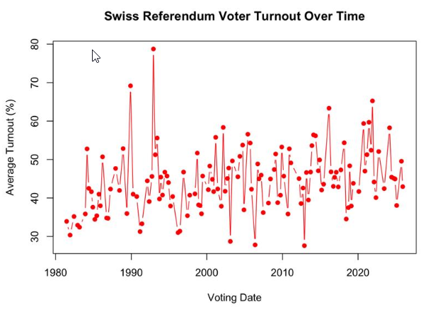

*Maletg da [Christian Marohn](https://pixabay.com/users/cm_ronaldo-29314232/?utm_source=link-attribution&utm_medium=referral&utm_campaign=image&utm_content=8345488) sin [Pixabay](https://pixabay.com/?utm_source=link-attribution&utm_medium=referral&utm_campaign=image&utm_content=8345488)*

*Quest artitgel è vegnì translatà da l'original tudestg cun agid da l'IA.*

L'ultima dumengia ha la Svizra puspè votà. Iniziativas federalas, propostas chantunalas e communalas e resultats che han fatg titels per intginas uras. Quai che ha fatg damain titels: dapli che la mesadad da las persunas cun dretg da votar n'han betg votà. Ellas han laschà decider in auter.

Quai n'è betg ina excepziun. Quai è la norma. E l'intschess che resta il pli savens a chasa èn ils giuvens creschids.

## Ina democrazia che pretenda bler

La Svizra è ina democrazia directa per concept. Pliras giadas per onn votan las citadinas ed ils citadins davart propostas concretas sin nivel federal, chantunal e communal. Ina dumengia da votaziun tipica porta intginas propostas federalas, intginas chantunalas e forsa ina da tia vischnanca. Sin in onn dat quai ina lunga glista da decisiuns che midan leschas, budgets u schizunt la constituziun.

Quai è remarcabel. Fitg paucs pajais dattan a lur populaziun uschè bler influenza directa. E tuttina, votaziun suenter votaziun, participescha mo radund la mesadad dals votants. L'ultima dumengia da votaziun n'è betg stada ina excepziun.

Datas: [opendata.swiss, datas en temp real als dis da votaziun federala](https://opendata.swiss/de/dataset/echtzeitdaten-am-abstimmungstag-zu-eidgenoessischen-abstimmungsvorlagen)

## Tgi resta a chasa?

La Svizra n'ha nagina statistica naziunala davart la participaziun tenor vegliadetgna. Ma intgins lieus la rimnan, per exempel il chantun Son Gagl, ed il maletg è cler: ils giuvens creschids votan bler pli darar che las generaziuns pli veglias. Tar intginas votaziuns van las persunas pli veglias bunamain duas giadas uschè savens a l'urna.

Il punct interessant: ils giuvens na èn betg simplamain indifferents. Els votan selectivamain. Sche in tema als pertutga directamain, sco las pensiuns, crescha la participaziun dals giuvens creschids visiblamain. Intginas emnas pli tard, tar temas che paran dalunsch, croda ella puspè.

Sche ils giuvens chapeschan pia dequai ch'i va e sentan ch'i als pertutga, van els a votar. La vaira dumonda è pertge che quai capita uschè darar.

## Dus pleds: infobesitad ed illiteralitad politica

Ils ultims mais avain nus discurrì cun las persunas enturn nus e stizzà tras studis e statisticas. Duas ideas èn adina puspè returnadas.

### Infobesitad

Tgi ch'ha gia ina giada avert ina cuverta da votaziun svizra sa tge che nus vulain dir. Tar ina dumengia chargiada ston ins decider a medem mument davart propostas federalas, chantunalas e communalas, mintgina davart in tema cumplettamain different. Politica exteriura sin ina pagina, agricultura sin la proxima, la renovaziun d'ina scola sin la terza. Intginas propostas vegnan cun ina cuntraproposta ed ina dumonda decisiva, quai che agiunta anc in ulteriur nivel da chapir.

Per declerar tut quai dat igl ils cudeschins da votaziun. Betg mo in, mabain in per mintga nivel: federal, chantunal e communal. Ensemen pon els empleni facilmain ina saira da lectura.

Ed ils cudeschins èn mo il punct da partenza. Per chapir propi las consequenzas d'ina decisiun dovri debattas, analisas da gasettas e mintgatant studis da spezialists. Entant basan las campagnas savens sin messadis emoziunals ch'èn fatgs per persvader empè dad infurmar.

Il problem n'è betg la mancanza d'infurmaziuns. Igl è memia bler dad ellas, senza ina via simpla per enconuscher tge ch'importa propi. Per bleras persunas è la reacziun la pli raziunala da betg cumenzar dal tut.

### Illiteralitad politica

Il segund problem è pli fundamental. Bleras persunas na san simplamain betg co che la democrazia svizra funcziunescha. Tge differenza datti tranter ina iniziativa ed in referendum? Pertge dovran intginas propostas ina maioritad dal pievel e dals chantuns? Co lantscha u suttascriva ins ina?

La gronda part da nus ha emprendì quai ina giada en scola, sche insumma, ed ha emblidà quai curt suenter. E sche ins na chapescha betg las reglas, cumenza il gieu a parair fatg per in auter. Precis uschia descrivan blers giuvens la politica: insatge per persunas pli veglias e bain infurmadas. Betg per els.

## Nossa resposta: AnyWell

Nus crain che omadus problems possian vegnir fatgs frunt a medema moda: cun render il savair politic pitschen, cler ed in pau divertent. E cun dar a la glieud in lieu nua che la politica na finescha betg cun emprender, mabain daventa conversaziun.

Perquai construin nus **AnyWell**, ina app da furmaziun civica davart la democrazia svizra.

### L'idea

Nagin n'emprenda ina lingua cun leger in gross cudesch da grammatica en ina saira. Ins emprenda ella en pitschens pass, intgins minuts il di, cun resposta immediata ed in motiv da returnar damaun. Nus pensain ch'il savair politic funcziunia a medema moda.

Ma savair co ch'il sistem funcziunescha è mo l'emprim pass. La democrazia viva dal fatg che la glieud discurra in cun l'auter, n'è betg perina e chatta ora nua ch'ella sa chatta. Perquai è AnyWell construida enturn duas chaussas: **emprender** e **far cun**.

### Emprender

**Tscherna in tema.** Las lecziuns èn gruppadas en temas, per exempel:

- *Bases da la votaziun:* co funcziunescha ina dumengia da votaziun? Tge capita cun tia cuverta?
- *Instituziuns:* tgi èn il Cussegl federal, il Cussegl naziunal ed il Cussegl dals chantuns, e tge fan els propi?
- *Tes dretgs:* tge differenza datti tranter ina iniziativa ed in referendum? Co lantscha u suttascriva ins ina?
- *Elecziuns:* co vegnan repartids ils sezs en parlament, e pertge importa tes chantun?

**Cumenza ina lecziun.** Mintga lecziun è ina curta seria da dumondas, da debutant fin avanzà. Tscherna singula, tscherna multipla u vair u fauss. Ina lecziun dura intgins minuts, betg ina saira.

**Emprenda da mintga resposta.** Suenter mintga dumonda vesas ti immediatamain sche ti has gì raschun, ensemen cun ina curta explicaziun. La finamira n'è betg da t'examinar. Ella è da garantir che ti bandunias mintga lecziun cun savair in pau dapli che avant.

**Va vinavant.** Ti survegns XP per mintga lecziun e construeschas ina seria per mintga di che ti emprendas. Pitschnas recumpensas, ma ellas gidan a trasfurmar «jau stuess propi chapir quai» en ina disa.

### Far cun

**Parta tia opiniun.** Ina giada che ti has chapì in tema, pos ti dir tge che ti pensas. Esser perina, betg esser perina, declerar tia vista e vesair co ch'ils auters vesan la chaussa. La politica para bler pli pauc dalunsch sche ins constatescha che persunas da la medema vegliadetgna discutan las medemas dumondas.

**Chatta tes partids.** Betg segir tge partid che represchenta propi quai che ti crais? Sin AnyWell pos ti explorar ils partids, vesair per tge ch'els stan e tscherner quels che van bain cun tai. Betg perquai ch'ina app ti di quai, mabain perquai che ti has sez fatg la cumparaziun.

**Scuntra ils politichers.** Er ils politichers pon sa participar a la plattafurma. Quai munta che ti na legias betg mo davart els en la gasetta. Ti pos vesair lur posiziuns, ils suandar e discurrer directamain cun els. La politica sa finescha dad esser insatge che capita «si enta aut» e daventa insatge cun tge ch'ins po discurrer.

### Neutral per concept

AnyWell sez na ti di betg co votar. Nossas lecziuns declerain co ch'il sistem funcziunescha e dequai ch'i va, senza prender partida. Las opiniuns sin AnyWell vegnan da ses utilisaders e dals politichers sin la plattafurma, e mintga partid è bainvegni. Nossa lavur è da furnir il palc, betg il text.

Nus n'essan era betg ina interpresa. AnyWell è in project da temp liber, construì dad ina pitschna squadra da students en noss temp liber, perquai che nus vulain che nossa atgna generaziun sa sentia a chasa en la democrazia svizra.

E damai che la Svizra discurra dapli ch'ina lingua, fa quai era AnyWell: tudestg, franzos, talian, rumantsch ed englais.

### Nua che nus essan

L'app è anc en svilup e betg anc lantschada. Nus partin noss progress, las ideas davos el e quai che nus emprendain sin la via gist qua sin il blog. Restai pia en trutg.

La Svizra na dovra betg dapli democrazia. Ella dovra dapli persunas che sa sentan prontas dad duvrar quella ch'ella ha gia.
